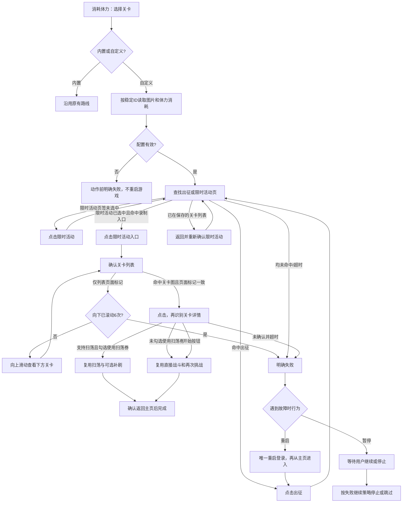

# 消耗体力：自定义活动关卡

自定义路线与内置路线共用[每日政务前置扫荡](daily_affairs.md)，完成后才进入截图关卡。运行时只覆盖 `DailyStaminaBattleStartAttempt` 的关卡导航，不覆盖 `DailyStaminaStartAttempt`，避免绕过政务或在恢复时重置门票额度。

主页出征使用Common/MainExpeditionButton720.png，默认匹配方法、阈值恢复0.82；活动和关卡的用户截图继续按录制配置匹配。该导航参数不代表实测通过，也不改变体力与购买额度。

## 功能目标

在“消耗体力”的“体力消耗关卡”下拉框中，直接选择唯一内置“日常调教本”或自定义关卡，并在同一步添加、管理多份命名配置。游戏更新后可重新截取，无需维护内置列表。

## 前置条件

- 先为当前实例连接ADB设备并加载资源扩展；自定义下拉选择和任务内管理入口在扩展加载后显示。
- 9:16竖屏，例如720×1280或1080×1920。自定义关卡仅支持“限时活动”，进入活动后须直接显示纵向关卡列表。
- 游戏已配置战斗队伍；点击关卡后应显示既有军团扫荡详情或底部开始按钮。

内置列表已移除过期活动和战争演习预设，仅保留日常调教本；用户新增的配置可随活动变化继续添加、删除。

## 选择、添加和管理

1. 打开“消耗体力”步骤的选项，“体力消耗关卡”同时显示内置关卡和本实例已保存的自定义关卡，自定义项以名称和“（自定义）”标注。
2. 下拉框末尾选择“＋ 添加自定义关卡…”，填写名称和单次体力消耗（1-999）。同一选项下的“管理自定义关卡”可编辑、重命名、复制或删除现有配置。
3. 点击“设置活动入口截图”，在游戏窗口打开“出征 → 限时活动”。点击“截取”后，助手确认“限时活动”已选中，再允许框选活动。
4. 点击“设置关卡截图”，在游戏中进入活动并找到目标关卡，按相同步骤从右侧实时画面框选名称或稳定图案。另自动保存顶部作为关卡列表页面标记。
5. 点击“保存并使用此关卡”，保存配置并在当前消耗体力步骤中选中该关卡。可关闭窗口继续设置“使用扫荡券”（默认不勾选）、扫荡补刷、体力药和体力购买开关。

切换配置保留编辑。点右上角 × 或“不保存并退出”会放弃未保存的修改。删除需二次点击并保存。任务按稳定配置ID关联，重命名后仍引用同一关卡；删除引用中的配置后显示缺失，执行前失败，要求重新选择。不同消耗体力步骤可以选择不同配置，保存不改变其他步骤的关联。

运行中也可修改、采图和保存。关卡选择随任务选项在下次启动队列生效；关卡配置的图片和单次体力消耗在对应步骤开始时读取，尚未开始的步骤会读到最新配置，正在执行的步骤及恢复继续使用已加载值。新图保存到不可变新路径，删除配置不删除旧图片，避免影响当前任务。详见[运行中修改配置](runtime_settings.md)。

截图窗口和配置编辑器都有“不保存并退出”按钮，也可按Esc。截图画面不对时直接退出，不产生新选区、不替换原截图；退出编辑器丢弃本次尚未保存的修改，之前已保存的配置不撤销。取帧中、画面冻结、没有选区和任务忙碌时仍可退出。

截图窗口只读取右侧实时画面缓存，不另启动 ADB 截图进程；页面操作仍在游戏窗口进行。图片按720×1280归一，拖框至少16×16且位于列表区域，避开菜单、底部导航、动画与倒计时；关卡顶部确认区域[50,60,600,80]不能被弹窗遮挡。

预览每0.5秒尝试读取缓存，上一帧仍在处理就跳过本次，不排队叠加。截取后停止刷新，重新截取后恢复；源画面更新较慢时可能重复显示同一帧。退出会停止刷新并取消未完成的取帧工作。

## 页面流程

## 关键分支和选项

- 自定义任务从主页、活动页或已知关卡列表继续。入口图片必须与选中的“限时活动”同帧命中，点击入口后才允许进入关卡列表路由。以关卡列表为起点时，先点击识别到的返回按钮，重新确认来源。定位使用TemplateMatch与识别框精确中点，限时活动页签沿用150毫秒按压。
- 限时活动选中状态需要文字图和底部亮线同时命中。亮线ROI `[485,159,140,7]`，用Maa ColorMatch RGB `[210,200,200]`至`[255,255,255]`、连通区域至少180像素。录制入口时在冻结的缓存画面复用同一套识别。
- 两个路由节点各最多命中30次，rate_limit为1000ms。主页出征最多六次，每次进入出征时限时活动页签最多三次；`CustomStageEnterExpedition`只在实际识别主页出征、排除已知遮挡且输入成功后恢复页签次数，使返回主页后的续接不被上次耗尽的次数封死。活动入口与关卡各三次，下滚六次及所有体力消费额度不重置。路由与主页入口总次数继续限制整个导航，不能仅靠清次数无限重试；没有可执行动作或达到上限仍明确失败。
- 点击关卡和向下滚动都先确认列表顶部。每次先找目标，向下最多6次，第六次后仍检查画面，耗尽明确失败。
- 图片匹配复用MaaFramework TemplateMatch，入口/关卡阈值0.85，出征与限时活动页签阈值0.82，均不代表准确率。页签位置或选中态样式变化时重新录制Common页签模板。
- 自定义Case才会进入本动作；任务级profile_id为空时回退实例最后选择的配置，避免已保存配置因前端覆盖丢失而直接报未选择。
- 体力消耗用于OCR读取当前体力后判断是否足够，并非游戏输入项。继续沿用现有扫荡补刷、用药与购买开关；恢复资源默认关闭，额度不增加。
- “使用扫荡券”默认关闭：即使有军团扫荡按钮，也走普通开始、战斗和再次挑战，不受扫荡补刷开关限制。勾选后才启用扫荡；仅有开始按钮时继续直接战斗。新模式只通过预定义Pipeline节点Override分流，普通战斗复用现有 `mode: direct` 子流程。
- 右侧实时画面未连接、缓存帧为空、横屏或图像无效时停止刷新并提示，用户恢复后主动刷新；截图窗口不另连接或切换设备。运行中允许编辑；设备正在连接或实例已关闭时暂不可编辑。
- 配置不完整、重名、非法体力消耗、图片缺失、路径越界和版本不兼容在动作前失败。导航和战斗异常沿用唯一重启恢复。

## 实现映射

| 模块 | 文件或节点 |
| --- | --- |
| 唯一用户任务 | assets/interface.json：消耗体力 / DailyStaminaStart |
| 内置列表和固定自定义存储项生成 | tools/build_stamina_activities.py / __TKFM_CUSTOM_STAGE__ |
| 下拉框扩展、当前任务内添加管理、右侧实时画面缓存裁剪及配置装配 | assets/resource/custom/TkfmCustomStage.cs |
| 任务稳定引用 | 体力消耗关卡Option.Data.custom_stage_profile_id；当前会话合并至pipeline_override.CustomStageConfig.attach.profile_id |
| 限时活动页签 | CustomStageLimitedActivitySelected、Common/LimitedActivityTab720.png |
| 无状态图片导航 | custom_stage.json：CustomStageActivityRouter、CustomStageMainExpedition、CustomStageOpenLimitedActivities、CustomStageOpenEntry、CustomStageLimitedListRouter、CustomStageOpenTarget、CustomStageScrollDown |
| 详情确认与战斗 | CustomStageConfirmDetail、CustomStageDirectBattle、既有DailyStamina节点 |
| 唯一异常恢复 | CustomStageWithRecovery → DailyStaminaStartAttempt |
| 兼容保留的配置和图片 | 实例TkfmCustomStageProfilesV1、安装目录userdata/resource/image/UserStages/；沿用UserStages相对引用 |

## 限制和完成状态

旧配置和截图继续保留，旧页签设置已失效。旧的每日活动配置在关卡管理中可重新录制为限时活动。两图仅覆盖活动入口后直达纵向关卡列表的路线；不处理额外分类、横向分页、二维地图或自动编队。顶部标记变化后须重新截关卡图。重命名不影响ID关联，复制得到独立ID，删除不物理清理图片，以免破坏共享引用。备份需同时保留实例配置和图片目录；用户图片由Git忽略。

图片与程序资源分离，官服和erolab均追加安装目录的userdata/resource作为第二资源包；编辑和预览只读写此持久目录，运行时仍用UserStages相对路径匹配。启动模块在资源加载及版本检查前自动复制旧资源图片，保留原图和完整备份，避免程序内更新清理resource时误删截图。首次从1.5接入的方式及旧版限制见[配置继承](config_migration.md)。

旧独立“自定义关卡”任务在扩展空闲加载时转换为“消耗体力”并保留配置引用和资源开关；日志与游戏设置不再提供自定义配置按钮。完成仍以既有流程确认主页为准，未知页面及次数耗尽不记为成功。
