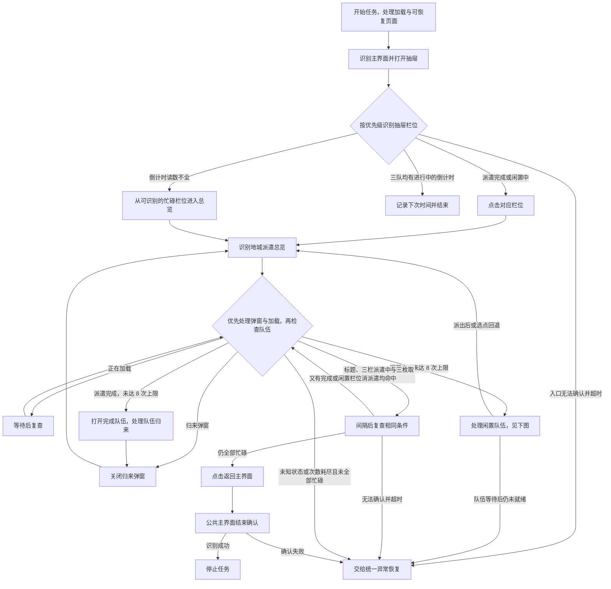
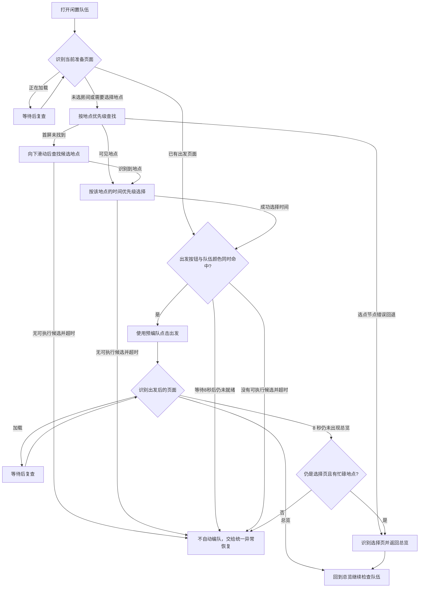

# 每日派遣（DailyDispatch）

主页通过 `Common/MainExpeditionButton720.png` 识别，匹配阈值为 0.85。

入口节点：`DailyDispatchStart`；实现文件：`assets/resource/pipeline/daily_dispatch.json`。

入口先经 `TkfmDispatchSchedule` 包装立即执行及定时队列，再由 `DailyDispatchRunNow` 经 [统一异常恢复](task_recovery.md) 执行 `DailyDispatchStartAttempt`。操作顺序可按配置不同，完成标准始终是全部三队已经派出。

## 前置状态

- 游戏位于主界面，地城派遣功能已解锁。
- 确认“派遣地点优先级”和“派遣时间优先级”。
- 所有需要助手处理的派遣栏位均已在游戏内编好可出发队伍；助手不会自动编队或补充角色。

## 设置自动最速派遣

点击任务列表中的「每日派遣」，在任务设置中开启「自动最速派遣」。助手按已算出的时间预约，没有有效时间时登记首轮派遣。开启后，任务名右侧会出现时钟，鼠标悬停可看下次派遣的本地时间或当前预约状态。

推荐将很多低级角色升到30级4星，这样自动派遣组队几乎不会失败。

三队都派出后，助手按最长倒计时加 5 秒计算下次时间。开启期间可在任务设置中点击「点击能够取消掉每日派遣」，关闭自动最速派遣并撤销尚未进入队列的预约。已经进入队列的本轮继续执行。关闭后，时钟和取消按钮都会隐藏，【任务说明】仍可查看已算出的时间。

如果上一轮独立派遣仍在收尾，普通队列读到的新倒计时会先保存，等旧预约恢复临时设置后再启用。

定时派遣和[定时执行所有日常任务](daily_schedule.md)共用模拟器启动、关闭开关。已经开机的设备直接复用。开启关闭开关时，派遣成功且设备空闲后关闭受支持的模拟器实例。

## 主流程

1. 打开左侧抽屉。三队均显示进行中的倒计时时，直接确认本轮完成并记录下次时间。出现“派遣完成”“闲置中”或读数不全时，进入派遣总览核对各栏。
2. 优先打开“派遣完成”栏位，收回队伍并关闭归来弹窗。
3. 打开“闲置中”栏位，按配置顺序选择地点和派遣时长。
4. 检查预先编好的队伍是否满足出发条件；满足后派出，继续扫描其他栏位。
5. 总览标题、三个栏位的“地城派遣中”及对应三枚“取消派遣”同时命中后，间隔复查一次，仍全部命中才返回并确认主界面。
6. 队伍未就绪时最多周期识别 8 秒，不进行编队；仍不可出发则明确失败，交给统一恢复，不按完成跳过。

“全部忙碌”通过 `__DailyDispatchSlot1Busy` 至 `__DailyDispatchSlot3Busy` 的独立窄 ROI
以及 `__DailyDispatchSlot1Cancel` 至 `__DailyDispatchSlot3Cancel` 的按钮 ROI 逐栏确认；
`DailyDispatchVerifyComplete` 与返回节点分别检查一次。完成和闲置候选优先，
复查期间新出现的目标仍交回原处理链。抽屉由 `DailyDispatchDrawerAllBusy` 逐栏读取非零倒计时。出发后的流程接受返回总览，亦可在异常恢复回到主页后重开抽屉确认三队状态。
公共结束确认见 [公共主界面恢复](common_navigation.md)。

闲置队伍的选点、选时与出发子流程如下。

选项通过调整候选顺序生效；图中不将某一个地点或时长视为固定默认。
滑动后的候选列表、各时间节点的继续尝试与错误回退以 Pipeline 为准，不表示任意选点失败都能返回总览。

## 页面识别

| 页面状态   | 识别目标                          | 识别方式            | ROI/素材         |
| ---------- | --------------------------------- | ------------------- | ---------------- |
| 抽屉栏位   | 派遣完成、闲置中、三队倒计时 | 局部 OCR 与状态检查 | 左侧各队栏位 |
| 派遣总览   | 地城派遣                          | OCR                 | 页面标题区       |
| 归来弹窗   | 队伍归来/隊伍歸來                 | OCR                 | 弹窗内容区       |
| 地点与时间 | 地点名称和对应时间按钮            | OCR + target offset | 选择页面         |
| 队伍就绪   | 出发按钮和队伍槽蓝绿色            | And + ColorMatch    | 队伍与底部按钮区 |
| 三队均派出 | 每栏地城派遣中及取消派遣按钮 | OCR + And | 三组独立栏位 ROI |

“取消派遣”三个 OCR ROI 基于已有设备截图的 720×1280 基准，分别为
`[500,925,145,60]`、`[500,1055,145,60]`、`[500,1185,145,60]`。
此处 OCR 用于安全复核完整按钮文字，不执行取消操作；不得用全屏重复文字数量代替逐栏判断。

## 异常与分支

- 点击左侧入口后依次识别加载、已打开的抽屉、派遣总览和主页。关闭晚出现的公告或广告后，若画面已回到主页且抽屉仍关闭，重新打开抽屉。`DailyDispatchEnterFromDrawer` 和 `DailyDispatchScanOverview` 也可从主页继续。
- 重开沿用 `DailyDispatchOpenDrawerFromMain` 的主页出征模板及遮挡排除条件。点击 720×1280 基准 `[35,630]`，局部稳定等待区域为 `[10,590,70,80]`。入口最多点击六次，恢复期间保留本轮派遣进度，完成条件仍由抽屉倒计时或总览逐栏复核。
- 出现“是否要回到标题画面？”时，统一恢复用正文与取消按钮实图双重确认后点击取消中心，再继续当前流程，见[统一异常恢复](task_recovery.md)。安卓系统返回原本已逐次检查主页，已回主页不发送下一次，保留该逻辑。
- 派遣步骤和本地回退均无法继续时，尝试最多三次安卓返回键，每次都检查是否已到无遮挡主页。返回或重启游戏确认主页后，共用导航重置和一次任务重跑，从 `DailyDispatchStartAttempt` 按当前画面区分已派出、待收取和闲置队伍。返回未确认主页时按既有故障策略处理。
- 打开抽屉后优先处理可操作栏位。提前确认完成要求三条非零倒计时来自同一帧。读数不足时从可识别的栏位进入总览。
  本模块不等待整屏静止，改为每秒周期识别；点击前的局部稳定等待为 300ms，超时 1500ms。
- 点击“出发”后优先等待游戏自动返回总览，不根据过渡期间其他地点的“正在派遣中”立即点击返回。
  8 秒内未进入总览时，只有选择页的“Bonus 奖励条件”和忙碌地点文本同时命中才执行返回；
  返回后重新判断总览或经公共节点确认主界面。出发与该回退均不等待整屏冻结。

- 队伍未满足出发条件时不自动编队或补充角色，等待后仍不可出发则明确失败，不使用返回主页的成功分支掩盖闲置队伍。
- `DailyDispatchCheckPreconfiguredTeam` 仅在识别到“出发”按钮后进入，不能以无条件节点抢在地点选择之前，否则会在尚未选点时误判队伍未就绪。
- 选点节点配置了返回总览的错误回退；返回后会继续扫描，可能再次进入闲置栏位，受最多 8 次打开限制。
  各时间节点的失败路径不同，不能保证所有“无可选时间”情形都能正常退出。
- 完成与闲置候选未命中后，必须连续两次同时确认总览标题、三栏派遣中与三枚取消派遣才执行正常返回。
  抽屉入口无法确认时不再仅凭主界面仍可识别就结束。
- “派遣完成”和“闲置中”栏位分别最多打开 8 次，为三队留出额外尝试，但异常识别不能
  无限重复。达到上限后只有三栏忙碌仍可通过完成检查；仍有目标或总览 6 秒内无法确认已知分支时失败，
  交由统一恢复。旧 `DailyDispatchReturnMainAfterOverviewTimeout` 与
  `DailyDispatchStopAfterOverviewTimeout` 也只转入明确失败节点，不再提供成功跳过出口。
- 首次异常按“遇到故障时行为”重启游戏或暂停；已派出的队伍由页面状态识别，不会取消重派。暂停解除或再次异常后执行失败继续策略。
- 地点/时间优先级通过 `pipeline_override` 调整 `next` 顺序，目标节点必须预先存在。
- 定时派遣入口显式传递空对象 `custom_action_param: {}`。自定义动作会把缺省参数兼容为 `null`、非法 JSON 转为可诊断失败，并且整个执行入口由异常保护包围，不能因参数解析错误终止前端。

## 完成状态

- 正常目标：收回完成队伍，并使用预编队处理可出发的闲置队伍。
- 正常成功条件：总览标题、三栏派遣中和三枚取消派遣均经两次检查，再返回并确认主界面。
- 队伍未就绪、上限耗尽且仍有目标、状态不明或入口无法确认时失败，交给统一恢复，不因只识别到标题或回到主页而报完成。
