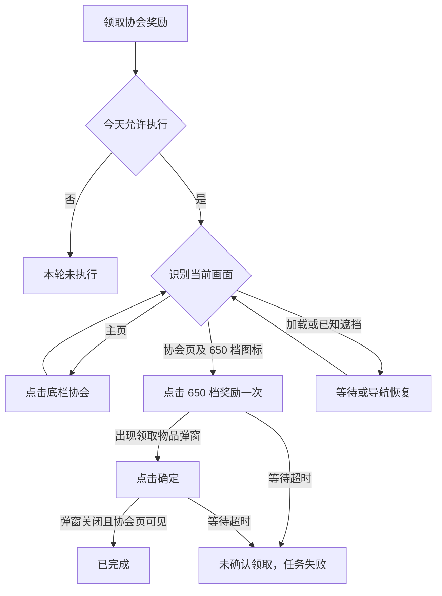

# 领取协会奖励

任务位于列表最后。目标为协会主界面「魔核共建」的 650 档奖励。需要已加入协会，可从游戏主界面或协会页开始。

| 选项 | 默认值 | 行为 |
| --- | --- | --- |
| 仅在周六周日开启 | 开启 | 按电脑本地日期判断。工作日直接跳过，保留上次实际运行历史。关闭后每天都可执行。 |

- 底栏协会入口和协会页各用一张实图识别。650 档模板只截取图标中央，匹配区域限在右下方 650 档位置，避开随领取状态变化的外圈。
- 复用「奖励领取」的弹窗和确定按钮识别。确认关闭后由 `DailyGuildRewardConfirmed` 记录完成。已领取、未达标等情况若点击后没有出现确认弹窗，按未确认处理。
- `DailyGuildRewardStart` 先判断星期，再进入恢复包装的协会流程。提交领取前可走常规恢复，提交后保留命中计数，结果无法确认时按故障设置报告或暂停，避免重启后重复提交。
- 实现为 `daily_guild_reward.json`、`TkfmDailyCompletion.cs` 以及 `DailyGuildReward/` 图片资源，通用弹窗识别位于 `daily_task_rewards.json`。
