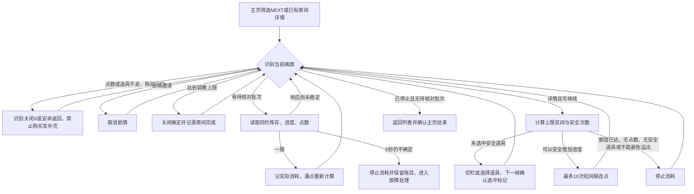

# 调教（DailyTraining）

入口 `DailyTrainingStart`；实现为 `assets/resource/pipeline/daily_training.json` 与 `agent/training.py`。
最外层初始化本轮账目，`DailyTrainingRun` 经[统一异常恢复](task_recovery.md)运行入口尝试；局部恢复和游戏重启不重新初始化账目。

## 前置状态与导航

- 从主界面调教图片入口进入列表；也允许直接从已打开的房间详情继续。
- 按原排序筛选入口下滑查找“调教进度”，在实际识别行右侧点击箭头直到“可调教”，确定后识图选择NEXT。
- NEXT所在的三行确定房间序号；从详情开始而没有列表依据时默认第三房。房间容量始终按当前画面计算，不将第三房标签当成300000的精确证明。
- 当前仍处理一个NEXT房间；完成或安全停止后返回列表和主页，不额外切换角色。
- 按配置先通用后活动或先活动后通用；备用栏仍无安全道具时停止。指定次数为1–100，全部点数以首次明确读取到的现有调教点为本轮上限，不补充点数。
- 初始化读取当前入口配置时，同时兼容 `next` 字符串和框架返回的节点属性对象，按 `name` 确认“全部点数”或“指定次数”；无法唯一确认则失败，不默认按3次运行。恢复沿用入口快照和已消耗账目，不重新分配点数。

## 页面驱动流程

Python不运行页面跳转循环。仅在明确识别当前详情、唯一选中安全道具及完整数字后执行一个有界输入批次；之后回到Pipeline优先检查弹窗。选物和场景点击不使用随机落点。

## 识别依据

| 对象 | 依据 |
| --- | --- |
| 主页调教、NEXT、详情标题、选中通用/活动页签 | ADB内部画面裁剪的720p模板 |
| 道具是否选中 | 槽位顶部青色箭头模板，通用与活动分别采样；必须只命中目标槽 |
| 桃子状道具 | 独立禁用图片；另禁止通用第四格和加成不低于2000的槽位 |
| 动态加成、单个增加百分比、库存、现有点数、当前进度 | OCR；文字随角色加成和房间变化，不能固定写死 |
| 点数不足 | 实图正文或“调教点不足／是否要购买禁忌果实”OCR |
| 道具不足与购买提示 | 动态提示OCR，已知提示只关闭，不确认任何资源操作 |
| 剧情与上限 | 保留正文加取消／确定的联合识别，点击按钮中心 |

OCR按实际数字框的行列区分百分比、加成和库存，排除道具图案误识别的其他数字；同槽重复、缺失或混淆的数字不放行。库存没读到不代表库存为零。

## 上限计算与点击前预估

设道具实际加成为 `v`，画面增量百分比换算为整数基点 `b`（0.17%为17），上限为整数 `C`：

`b - 0.5 <= 10000*v/C < b + 0.5`。

联合所有可读道具给出的整数区间，并保留本房间切栏前的证据。约300000等整值仅用于日志估计；如果区间不是单值，不能当作精确容量。
当前进度同样有半个基点舍入误差；使用最小可行容量与最大可行当前点数得到保守剩余值。

每批次数取以下最小值：10、已确认次数后的本轮余额、当前点数、目标库存、保守剩余值除以单个加成的整数商。
只使用完整能容纳的道具，临界点不能证明安全时停止；不通过最后一个可能溢出的道具强求100%。日志报告当前进度、容量估计及范围、剩余下界、选中哪格、单个加成、库存、点数和拟点击次数。

## 连点后核对与补点

- 连点位置为手操确认的 `[75,450]`，位于已观察的中部弹窗控件之外；每次间隔120ms，至多10次，不长按，不等待角色全屏静止。
- 发送前登记批次，逐次预占输入；只有实际库存减少且进度增量与对应道具相容、点数没有异常额外扣除才结算。发送成功不算游戏已消耗。
- 足额响应立即结算；少扣时，至少两次观察一致、批次结束至少800ms且库存稳定至少300ms后，才重新计算补点，不能按原计划整批重放。
- 5秒仍无法核实则明确失败并保留待确认记录，恢复或重启不补发额度。连续三批零消耗、连续六次数字不明、选物三次仍无法确认都停止。
- 一轮累计输入还有独立上限 `3*本轮额度+30`，页面循环有有限命中次数；不允许无限补点或无限日志输出。

## 资源保护与完成状态

- 永久禁用桃子及高价值道具；设置中移除珍贵道具开关。旧选项定义和目标节点只为配置兼容保留，Yes也不能放行。
- 点数不足弹窗包含“补充能量”和“购买”两个资源按钮，二者均不可点击。优先匹配下方关闭X；未知位置不猜坐标，退回安卓返回键。
- 发生剧情邀请时取消，不观看剧情；上限提示关闭后核对当前房间和已有消耗。弹窗关闭不等于批次结算。
- 完成指定实际消耗次数、用尽本轮点数、房间已满、无安全可用道具或临界点无法避免溢出，都可在明确说明原因后正常返回。仍有未核实消耗时不能当作正常完成。
- 开始日志明确本轮目标；全部点数首次读取后报告点数额度。额度、零点数或房间完成导致结束时，同时报告当前剩余点数和房间进度；不能用“达到默认次数”说明全部点数完成。
- 返回使用左上小区域短稳定等待，所有局部等待均有短超时；本模块无全屏静止等待或20秒动画等待。

实际手操观察与新增代码验证分别记录；本轮未自动执行改造后的任务，前两房、房间临界点及道具耗尽弹窗仍待实机覆盖。
